<h2 data-importer="text" align="left">Oi, Ana Rita aqui :) 👋</h2>

Graduanda em Ciência da Computação pela Universidade Federal de Campina Grande (UFCG), possuo mais de 2 anos de experiência em projetos de Pesquisa, Desenvolvimento e Inovação. Atualmente, trabalho em um módulo da reforma tributária, recém criado para um sistema fiscal já consolidado no mercado, utilizando princípio de SDD para desenvolvê-lo. Já liderei equipes em outras frentes desse projeto. Além disso, monitorei algumas disciplinas ao longo da graduação, dentre elas: Engenharia de Software, ATAL e Banco de Dados.

####

- 🔭 Atualmente bolsista em projeto PD&I na UFCG.
- 🌱 Atualmente estudo e utilizo Spec-Driven Development em minhas atuações.
- 📚 Realizando o TCC no tema de GraphRAG, correlacionando chamados de cliente com issues no board.
- 👯 Adoro videogame e jogar nos tempos livres, tanto jogos digitais, quanto jogos de tabuleiros.
- 😄 Pronomes: Ela/Dela.

###

  
  

###

###

  
  
  
  
  
  
  
  
  
  
  
  
  
  
  
  
  
  
  
  
  
  
  

###

  
  

###

 

###
